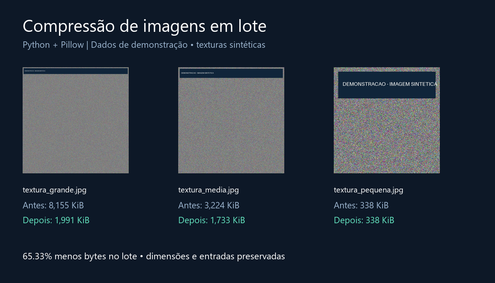

# Compressão de imagens em lote com Python

**Autor do projeto original: Enzo Zapparolli.** Versão de demonstração adaptada com assistência de IA.

[Portfólio](https://github.com/Enzo-Zapparolli) · [Código](comprimir_imagens.py) · [Validação](VALIDACAO.md)



## Resultado demonstrativo
Três imagens processadas, com **65,33% de redução em bytes** e dimensões preservadas. Os números são do teste sintético e não medem resultados de uma empresa.

## Problema
Preparar lotes de fotos para cadastro em um sistema com limite de tamanho por arquivo. A solução automatiza a compressão JPEG e mantém os originais.

## Funcionamento
1. Localiza JPG/JPEG na pasta de entrada (sem percorrer subpastas).
2. Valida a imagem e copia arquivos já dentro do limite.
3. Testa qualidades de 95 a 40, em passos de 5, mantendo as dimensões.
4. Salva apenas resultados dentro do limite e gera relatório CSV com tamanho, qualidade e tempo.

Limite padrão: **2.091 KiB (2.141.184 bytes)**; a opção usa o nome `--limite-kb` por compatibilidade com o script original. O programa não promete atingir qualquer limite: imagens que exigem qualidade inferior a 40 são registradas e não são salvas. Os arquivos de destino existentes não são sobrescritos. Arquivos pequenos são copiados integralmente, inclusive eventuais metadados; use somente as imagens sintéticas desta demonstração para publicação.

## Executar
No terminal, dentro desta pasta:

```powershell
python -m pip install -r requirements.txt
python gerar_demo.py
python comprimir_imagens.py exemplos/entrada exemplos/minha-saida --limite-kb 2091
```

Escolha uma pasta de saída nova a cada execução. O relatório da execução demonstrativa está em `exemplos/saida/relatorio.csv`. Gere as entradas com `gerar_demo.py` antes de executar a compressão. O script gera texturas abstratas localmente, sem fotografias de pessoas ou dados corporativos.

## Evidências e limites
Consulte `resultado_demo.json`, `exemplos/saida/relatorio.csv` e `comparativo.png`. O tempo medido na demonstração depende da máquina e não representa o tempo da experiência profissional. O relato histórico de aproximadamente dez minutos deve ser apresentado como estimativa da experiência, sem converter em percentual de economia não medido.

## Evolução em relação ao original
Remoção do caminho corporativo fixo, argumentos de linha de comando, relatório, validação de entrada e proteção contra sobrescrita. A lógica central continua sendo compressão progressiva com Pillow. Não há redimensionamento em pixels.
